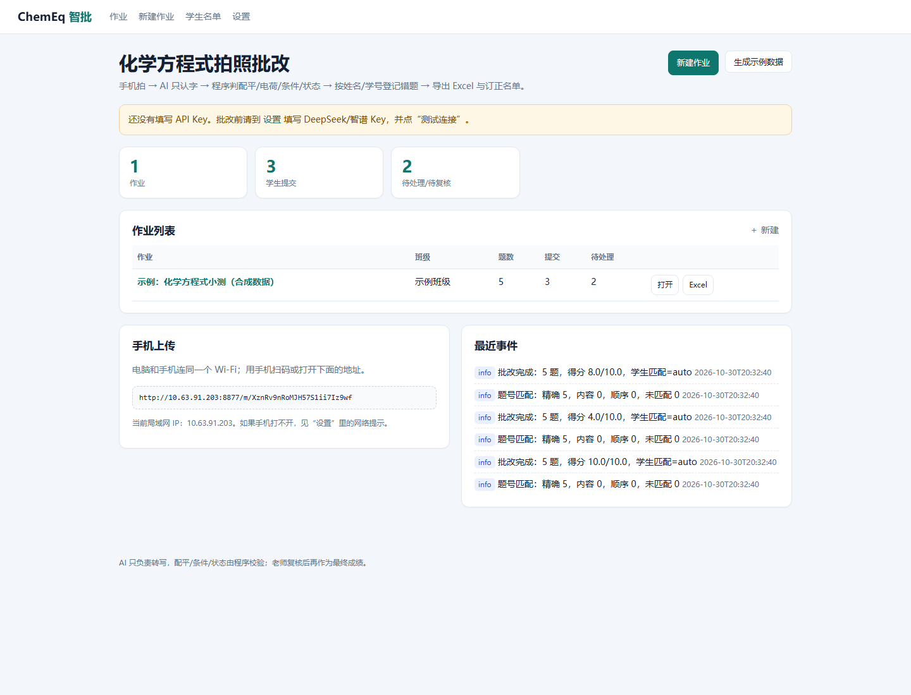

# ChemEq Grader · 高中化学方程式拍照批改

手机扫码拍学生的方程式卷 → AI 只负责“认字” → 程序按化学规则检查配平、电荷、条件、↑↓、状态符号 → 按卷面姓名/学号把错题登记到学生名下 → 导出 Excel / 可打印的订正报告。

> **定位**：给一线化学老师用的本地小工具，不是“全自动阅卷系统”。AI 只转写，判分由确定性解析器完成；老师复核后才算最终成绩。



## 为什么不是“让大模型直接打分”

大模型能看懂方程式，但**配平、电荷、条件、↑↓ 是确定性规则**，让它心算容易“看起来对、实际错”。本项目的分工：

- **VLM（DeepSeek `deepseek-flash`）只做转写**：把学生手写的方程式原样变成文字，写错了也照原样转写，不纠正。
- **程序判分**：解析化学式、数元素、算电荷、比对条件/状态/箭头/ΔH，给出可解释的错因。
- **老师复核**：发现认错字，改掉转写文本点“保存”，程序立刻重判，**不再调用 API、不再花钱**。

## 功能

- 手机扫码拍照/选图上传，局域网直传，不注册小程序、不备案；支持**整摞上传按每 N 页分组**、同一学生多页、每张一位三种模式。
- 化学方程式、离子方程式、热化学方程式（ΔH）、常见有机 condensed 式。
- 严格评分：只要有一点错就是 0 分（老师要求）；报告里仍写清错因。
- 按卷面姓名/学号匹配名单；匹配不上进入“待确认”，不会记到别人名下。
- 自动匹配不准时，可把识别结果**手动填入**任意题号。
- Excel 六张表：学生汇总、错题明细、题目统计、错题矩阵、订正名单、逐题明细。
- 可打印学情报告（浏览器打印/导出 PDF）。
- WorkBuddy 技能 + MCP：老师可以在 WorkBuddy 里一句话调用；也提供让它生成薄前端的 build-kit。
- Windows 免安装 zip，双击 `启动智批.bat` 即用。

## 快速开始（老师版）

1. 下载 Release 里的 `chemeq-grader-0.1.2-windows-x64.zip`，解压到 `D:\智批`。
2. 双击 `启动智批.bat`，浏览器打开 `http://127.0.0.1:8765`。
3. 设置里填 DeepSeek API Key（Base URL：`https://api.deepseek.com`，模型：`deepseek-flash`），点“测试当前模型”。
4. 新建作业，把标准答案逐行粘贴进去：

```text
1. 2H2 + O2 --点燃--> 2H2O
2. 2KClO3 --MnO2,Δ--> 2KCl + 3O2↑
3. H2(g) + 1/2O2(g) → H2O(l) ΔH = -285.8 kJ/mol | 2
```

5. 手机和电脑连同一个 Wi-Fi，扫码上传；电脑上复核、导出。

详细步骤：[老师 5 分钟上手](docs/teacher-guide.md)。

## 开发版

```bash
uv sync
uv run chemeq demo          # 合成示例数据，不需要 API Key
uv run chemeq serve --open  # http://127.0.0.1:8765
uv run pytest -q
```

命令行：

```bash
uv run chemeq worksheet create --title "钠及其化合物小测" --class-name "高二(1)班" --answers answer_key.txt
uv run chemeq roster import --file roster.csv
uv run chemeq grade --folder "D:/作业/周三" --worksheet 1 --json
uv run chemeq report --worksheet 1 --out report.xlsx
uv run chemeq doctor --net
```

## 成本（实测，按 2026-10 DeepSeek 价）

- 合成 5 题一页：1,110 输入 + 129 输出 tokens，约 **¥0.0018/页**（off-peak）。
- 真实手写一页（12 道方程式）：1,301 输入 + 500 输出 tokens，约 **¥0.0036/页**。
- 一个班 40 页：约 **¥0.07–0.15/班**（off-peak；峰时翻倍）。夜间批改更便宜。

价格会变，`src/chemeq/pricing.py` 里有单价表；以账单为准。

## 支持范围 / 已知限制

**支持**

- 化学方程式、离子方程式、氧化还原半反应（含 `e-`）
- 配平、电荷、条件（点燃/加热/高温/催化剂/通电/光照等）、↑↓、状态符号、结晶水、`(浓)/(稀)/(少量)/(过量)`
- 热化学方程式的 `ΔH = … kJ/mol`（含分数系数）
- 常见有机 condensed 式（`CH3COOH + C2H5OH ⇌ …`）

**不保证**

- 有机结构式/键线式、复杂络合物：会标“无法解析”，进复核。
- 一题下有多个方程式：请拆成两个题号（如 `6(1)`、`6(2)`）；否则会标“无法解析”。
- 手写潦草/照片模糊：转写会出错，老师必须在复核页核对原图。
- 微信小程序：需要已备案 HTTPS 域名和公网服务器，无法直接访问老师电脑；本项目用手机网页替代。

## WorkBuddy

```powershell
powershell -ExecutionPolicy Bypass -File integrations\workbuddy\install.ps1 -ChemeqExe "D:\智批\chemeq.exe"
```

安装后可在 WorkBuddy 里说：

> 帮我把 `D:\作业\周三` 里这摞方程式批了，登记错题，出报告。

详见 [WorkBuddy 适配](integrations/workbuddy/README.md)。

## 隐私

- 程序、数据库、原图、成绩、名单都在老师电脑的 `%LOCALAPPDATA%\ChemEq`（便携模式可改）。
- 识别时会把**压缩后的作业图片**发给所配置的模型服务（默认 DeepSeek）；首次使用请确认学校/家长允许。
- 不收集遥测，不上传到本项目作者；API Key 只存本地。
- 需要完全离线时，可把 Base URL 改成局域网 Ollama 的 OpenAI 兼容地址（需要显卡，速度慢）。

见 [隐私说明](docs/privacy.md)。

## 架构

```
手机浏览器 ──局域网 HTTP + token──▶ FastAPI
                                   ├─ 图片预处理（EXIF/缩放/去重）
                                   ├─ VLM 转写（仅认字）
                                   ├─ 确定性判分（配平/电荷/条件/状态/ΔH）
                                   ├─ 姓名/学号匹配 + 错题登记
                                   └─ Excel / HTML 报告
WorkBuddy ──技能/MCP──▶ 同一套本机 CLI / DB
```

## 开发文档

- [快速开始](docs/quickstart.md)
- [判定规则](docs/grading-rules.md)
- [常见问题](docs/faq.md)
- [验收记录](docs/validation.md)
- [贡献指南](CONTRIBUTING.md)

## License

MIT。模型服务、第三方库的许可与条款请自行确认。
