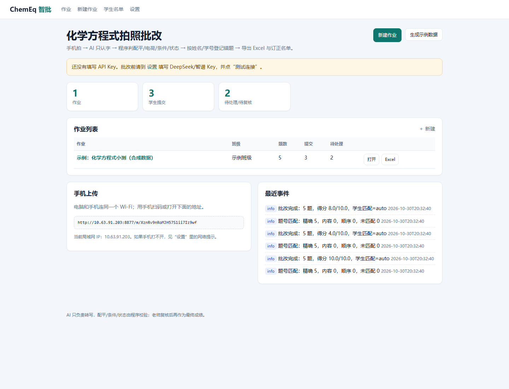
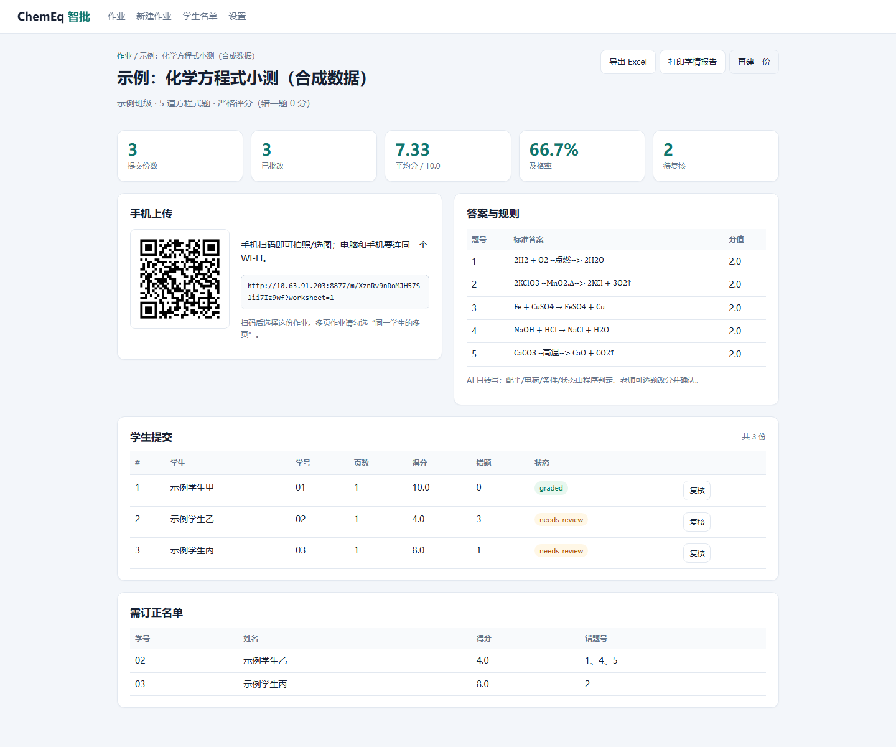
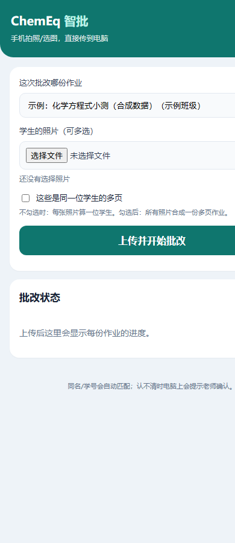
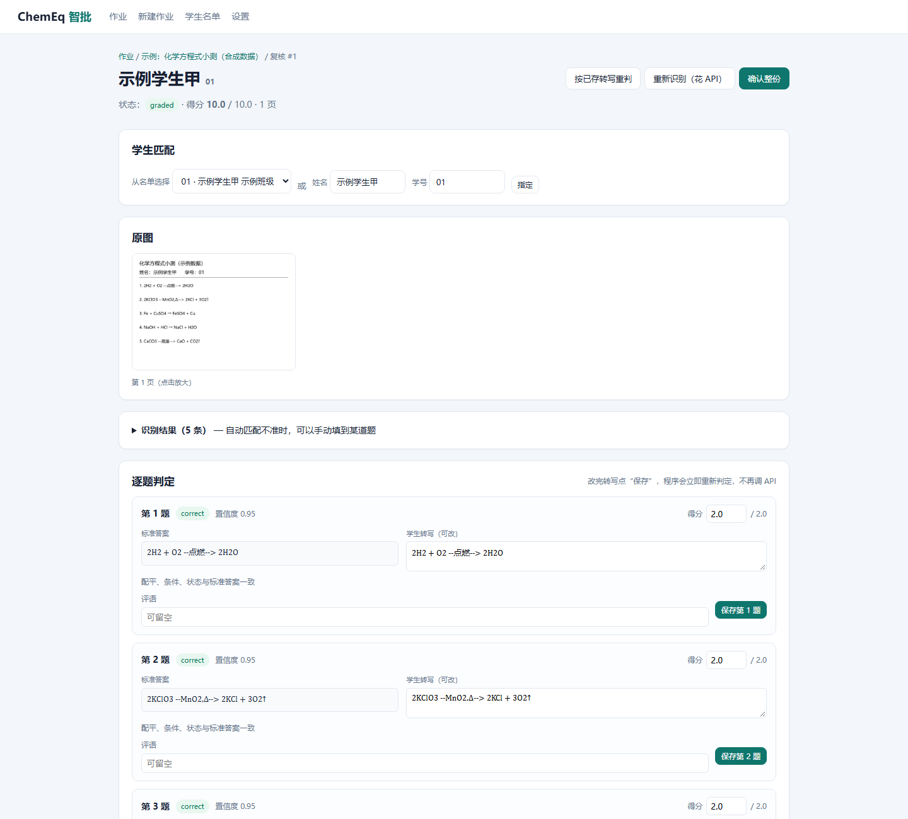
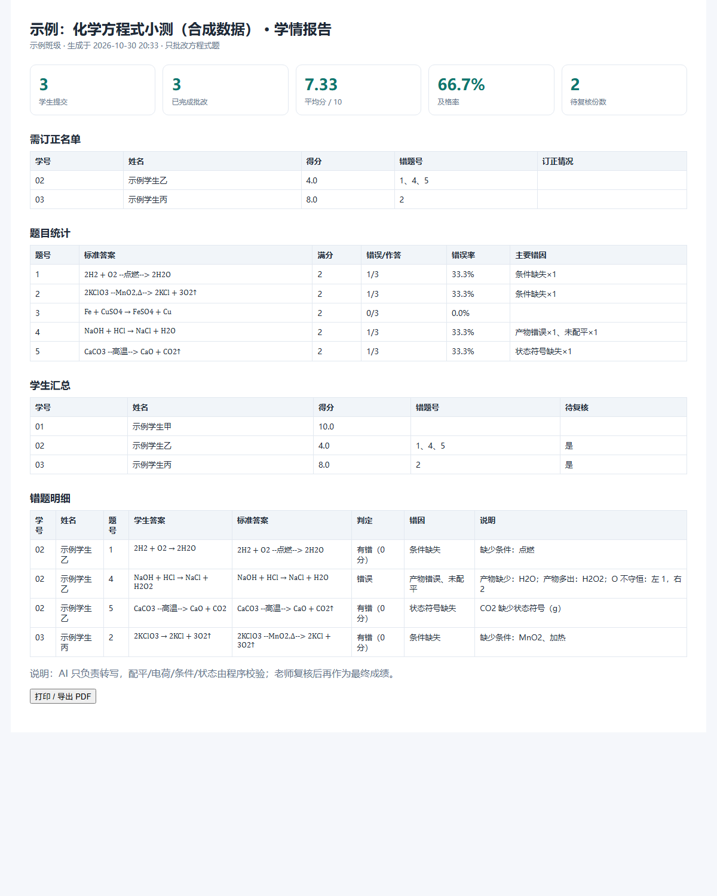

# 老师 5 分钟上手

## 1. 启动

解压后双击 `启动智批.bat`，看到浏览器打开这个页面：



如果浏览器没自动打开，手动访问窗口里显示的 `http://127.0.0.1:8765`。

## 2. 设置 API Key

点右上角“设置”，填：

- 模型：`deepseek-flash`
- Base URL：`https://api.deepseek.com`
- API Key：你的 DeepSeek Key

点“测试当前模型”，显示“连接成功”即可。

> 费用：一个班 40 页大约几毛钱；夜间更便宜。以 DeepSeek 账单为准。

## 3. 建作业

点“新建作业”，粘贴标准答案，每行一题：

```text
1. 4Na + O2 → 2Na2O
2. 2Na + 2H2O → 2NaOH + H2↑
3. NaHCO3 + HCl → NaCl + H2O + CO2↑ | 2
```

- 题号用**卷面印刷题号**；同一题多个小问用 `6(1)`、`6(2)`。
- 分值不写默认 2 分；写 `| 3` 就是 3 分。
- 同一题有多个可接受答案，用 `；` 分隔。
- 热化学方程式写 `ΔH = -285.8 kJ/mol`；分数系数写 `1/2`。
- 只批改方程式题；非方程式题可以留在卷面上，不影响报告。

如果答案在 Word 里，可以在本页选 `.docx` 点“提取到上面”，然后**逐条核对题号和条件**。



## 4. 手机上传

电脑和手机连同一个 Wi-Fi。手机扫上面的二维码，选择作业，拍照/多选。

- **不勾选**“同一学生的多页”：每张照片算一位学生。
- **勾选**：这些照片合成一份多页作业。
- 上传后手机会显示“排队/识别中/已批改/待复核”。



## 5. 复核（最重要）

在电脑上点“复核”：



- 左边是原图，右边逐题显示“学生转写 / 判定 / 错因 / 得分”。
- 发现 AI 认错字：直接改“学生转写”，点“保存第 X 题”，程序立刻重新判定，**不再花钱**。
- 自动匹配不准：展开“识别结果”，把某条转写“填入”对应题号。
- 姓名/学号没匹配上：在“学生匹配”里选名单或填姓名/学号；程序不会乱记。
- 确认整份后，状态变成 `confirmed`。

老师要求“出错就不给分”，所以只要程序判定有错，就是 0 分；报告里会写清是“未配平/条件缺失/产物错误/状态符号错误”等。

## 6. 导出

- “导出 Excel”：学生汇总、错题明细、题目统计、错题矩阵、订正名单、逐题明细。
- “打印学情报告”：浏览器打印/另存为 PDF，含需订正名单和错题明细。



## 7. 常见情况

- **手机打不开**：先允许 Windows 防火墙；或电脑连手机热点。仍不行看 `诊断.bat`。
- **端口被占用**：程序会自动换端口，以启动窗口里显示的地址为准。
- **照片太糊/字太草**：程序会标“无法解析/待复核”，改转写或手动填分。
- **一题写了两个方程式**：请拆成两个题号；否则会解析失败。
- **有机结构式**：v0.1 只支持 condensed 式；结构式会进复核。
- **流程会改学生数据吗**：不会改原图；删除作业才会删除对应图片。
